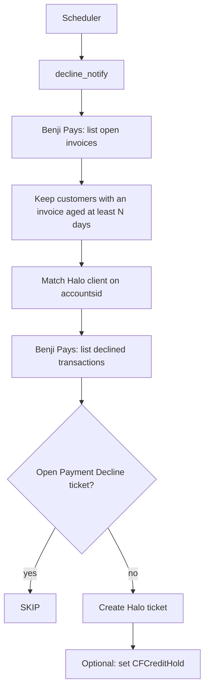

# Benji Pays payment decline notify for Halo

Sample for MSP engineers. When a customer has an open Benji Pays invoice that is at least 10 days past due, and Benji Pays has at least one declined payment for that customer, this script opens a Halo ticket of type Payment Decline. If an open ticket of that type already exists, it does not open another one. Setting the Halo client field `CFCreditHold` is optional.

Halo with an accounting sync can see an open balance. Only Benji Pays sees that a payment was declined. This sample connects those two facts.

## Policy

A customer qualifies when all of the following are true:

1. Benji Pays has an open invoice for that customer (`status=open` includes unpaid invoices that are past due).
2. The invoice due date is at least `--invoice-age-days` days before today (default 10), in `TIMEZONE` (default UTC).
3. The invoice balance is greater than 0.
4. Benji Pays has at least one transaction with `status=declined` for that accounting customer id.

The decline check is per customer, not per invoice. A decline from any date counts. This sample does not apply a lookback window.

Join key: the Halo client custom field `accountsid` equals the Benji Pays accounting customer id (`customer.id` on an invoice, and `customerId` on a transaction). Name matching is off unless you pass `--allow-name-match`.

Dedupe: if that Halo client already has an open ticket of type Payment Decline, the action is `SKIP`.

Credit hold: off unless you pass `--set-credit-hold`. The sample then sets `CFCreditHold` to true on the Halo client when it creates a ticket. It does not clear the field later, and it does not close the ticket when the customer pays. An agent does that.

## Architecture



The diagram is the cookbook script. It calls Benji Pays and Halo directly. It does not start a Halo runbook. The same policy can also be run by an agent, or shown as a finished Halo Integration Runbook. This script is the reliable sample. The webinar outline is [DEMO.md](DEMO.md). If you use a Halo runbook, read the limit in [docs/halo-integration/README.md](docs/halo-integration/README.md) before you rely on a runbook condition.

## Prerequisites

- Python 3.10 or newer. The sample uses the standard library only.
- A Benji Pays organization API key that can read invoices and transactions. See [docs/BENJI_PAYS_SETUP.md](docs/BENJI_PAYS_SETUP.md).
- A Halo API application (client credentials) that can read clients, read tickets, create tickets, and update client custom fields.
- In Halo: ticket type **Payment Decline**, client field **CFCreditHold** (yes/no), and client field **accountsid** filled with the accounting customer id. See [docs/HALO_SETUP.md](docs/HALO_SETUP.md).

## Quick start

```bash
git clone https://github.com/bpays/bp-cookbook-halo-payment-decline-notify.git
cd bp-cookbook-halo-payment-decline-notify
cp .env.example .env
```

Edit `.env`. Then do a dry-run. Dry-run is the default. It does not create tickets.

```bash
python3 -m decline_notify --all
```

Read the summary. `WOULD_CREATE` is a customer the script would ticket. `SKIP` means an open Payment Decline ticket already exists. `UNMAPPED` means no Halo client has that `accountsid`. `NOOP_NO_DECLINES` means the invoice is old enough but Benji Pays has no declined payment. `NOOP_NO_AGED_INVOICE` means the customer was not old enough (you will see this in single-customer mode).

When the dry-run looks right, apply it for one test customer:

```bash
python3 -m decline_notify --customer YOUR_ACCOUNTING_ID --halo-client YOUR_HALO_CLIENT_ID --apply
```

Add `--set-credit-hold` on that command if you also want `CFCreditHold` set. Run the same command again. The second run should say `SKIP`.

Org-wide apply, after you trust the dry-run:

```bash
python3 -m decline_notify --all --apply
```

Results are written to `data/` unless you pass `--no-write`. `data/` is gitignored.

## Flags

| Flag | Meaning |
|------|---------|
| `--all` | Scan every open Benji Pays invoice. |
| `--customer ACCT_ID` | One accounting customer id. Requires `--halo-client`. |
| `--halo-client ID` | Halo client id for `--customer`. |
| `--customer-name NAME` | Name on the ticket summary. |
| `--invoice-age-days N` | Days past the due date. Default 10. |
| `--apply` | Create tickets. Omit this for a dry-run. |
| `--set-credit-hold` | Set `CFCreditHold` when a ticket is created. |
| `--allow-name-match` | With `--all`, fall back to the Halo client name. Off by default. |
| `--json-out PATH` | Also write JSON to this path. |
| `--no-write` | Skip the default `data/*.json` file. |

## Actions

| Action | Meaning |
|--------|---------|
| `WOULD_CREATE` | Dry-run. A ticket would be created. |
| `CREATE` | Apply mode. The ticket was created. |
| `SKIP` | An open Payment Decline ticket already exists. |
| `NOOP_NO_AGED_INVOICE` | No open invoice is old enough, or the balance is 0. |
| `NOOP_NO_DECLINES` | The invoice is old enough, and there is no declined payment. |
| `UNMAPPED` | `--all` only. No Halo client matched. |
| `ERROR` | That customer failed. `--all` continues with the next customer. |

## Settings

Copy [.env.example](.env.example). Required names: `BENJI_PAYS_API_KEY`, `HALO_RESOURCE_URL`, `HALO_AUTH_URL`, `HALO_CLIENT_ID`, `HALO_CLIENT_SECRET`.

The default Benji Pays API host is `https://api.benjipays.com`. <!-- // pragma: allowlist secret -->
The default customer link host is `https://app.benjipays.com`. <!-- // pragma: allowlist secret -->
The ticket link path is `/app/customers/s/{accountingCustomerId}`. Change `BENJI_PAYS_APP_URL` if your portal host differs.

Ticket type id is looked up by name (`Payment Decline`) unless you set `HALO_PAYMENT_DECLINE_TICKET_TYPE_ID`. Do not copy an id from another Halo tenant.

## Schedule

See [docs/SCHEDULING.md](docs/SCHEDULING.md). Run a dry-run by hand before the first `--apply` on a schedule.

## Security

Keep `.env` off the git remote. Use a Benji Pays key that can read invoices and transactions, and a Halo application that can only do the calls this sample makes. If a key leaks, revoke it, then report the leak in private. See [SECURITY.md](SECURITY.md).

## Halo runbooks

This script is the reliable sample. An agent, or a finished Halo Integration Runbook, can follow the same policy. The webinar outline is [DEMO.md](DEMO.md).

A Halo Integration Runbook condition on a mapped list count is not a reliable gate. Do not use it to decide from a decline count or an open ticket count. Optional method notes: [docs/halo-integration/README.md](docs/halo-integration/README.md). This repo does not claim a one-click import that works on every tenant.

## Tests

```bash
pip install -r requirements-dev.txt
pytest -q
```

Tests use fixtures. They do not call Benji Pays or Halo.

## Contributing

Issues and pull requests are welcome. Fork the repo, branch, and open a pull request. Do not push to `main`. Benji Pays org admins review and merge. See [CONTRIBUTING.md](CONTRIBUTING.md).

## License

MIT. Copyright (c) 2026 Benji Pays. See [LICENSE](LICENSE).
